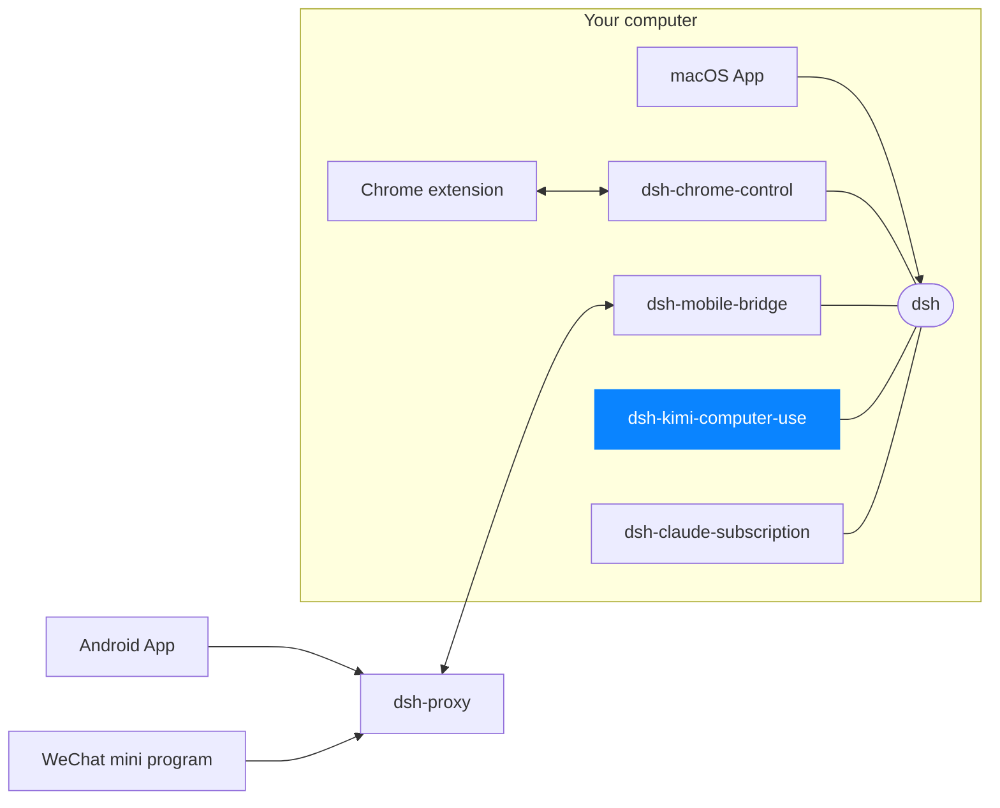

# dsh-kimi-computer-use

[中文](README.zh.md)

A [DeepSeek Harness (DSH)](https://github.com/deepseek-ai/deepseek-harness) bundle that wires [Kimi Computer Use](https://www.kimi.com/)'s stdio MCP server into DSH through the generic [`@deepseek-ai/dsh-mcp-client`](https://www.npmjs.com/package/@deepseek-ai/dsh-mcp-client) bridge, plus a bundled skill that drives it once connected.

This is a third-party interoperability plugin. Its inclusion does not imply endorsement, recommendation, partnership, or ongoing support by DeepSeek or by Moonshot AI (the maker of Kimi Computer Use).

## What this bundle does and does not do

| Concern | This bundle | You / KimiCU.app |
|---|---|---|
| Insert one `@deepseek-ai/dsh-mcp-client` row that starts `kimi-cu mcp` over stdio | Yes | — |
| Discover and register KimiCU's MCP tools as `mcp__cu__<tool>` | Yes | — |
| Register the bundled `kimi-computer-use` skill (interaction loop + safety rules) | Yes | — |
| Download, verify, or install `KimiCU.app` | No | Yes — install from the official Kimi channel |
| Bundle ID / arm64 / Team ID / `codesign` verification | No | Handled by KimiCU.app's own installer |
| Start, stop, or supervise the KimiCU background service | No | Yes — keep the app running yourself |
| Grant Accessibility / Screen Recording permissions | No | Yes — grant them in the KimiCU.app UI |

DSH starts and stops the `kimi-cu mcp` stdio child process with this plugin's lifecycle; it does not manage KimiCU.app itself.

## Requirements

- Apple Silicon Mac, macOS 14 or later.
- [`KimiCU.app`](https://www.kimi.com/) installed from the official Kimi channel and left running, with Accessibility and Screen Recording granted in its own UI.
- A DSH installation (`@deepseek-ai/dsh`) whose `dsh` CLI ships `@deepseek-ai/dsh-mcp-client` in-box (true for published `@deepseek-ai/dsh >= 0.1.1-rc.2`).

## Install

Into a profile (see the [plugin-and-profile tutorial](https://github.com/deepseek-ai/deepseek-harness/blob/main/docs/user/develop/basic/publish.md) for the full mechanism):

```sh
dsh plugin --profile demo add dsh-kimi-computer-use          # once published to npm
dsh plugin --profile demo add ./dsh-kimi-computer-use        # from a local checkout
dsh plugin --profile demo add github:<you>/dsh-kimi-computer-use#<sha>   # from git, pinned to a commit
```

The git form runs this package's `prepare` script to build `lib/skills.js` from source; pnpm ≥10 blocks that script until you allow it. If `dsh plugin` reports the build was blocked, add the exact package key it printed to the profile's `pnpm-workspace.yaml`:

```yaml
allowBuilds:
  dsh-kimi-computer-use: true
```

then re-run the `add` command. Only allow builds for a package whose source you trust, and pin a commit so a later push cannot silently change what runs at install time.

Verify without booting, then boot:

```sh
dsh --profile demo --dump-config   # shows a "# == dsh-kimi-computer-use" layer
dsh --profile demo
```

Remove with `dsh plugin --profile demo remove dsh-kimi-computer-use`.

## Verify

1. After boot, wait for the `mcp__cu__*` tools to appear (discovery is asynchronous).
2. Ask the agent to list open applications. Confirm it calls `mcp__cu__list_apps` (or the equivalent discovered tool) and returns a real result from your running KimiCU.app.
3. For any GUI action, the bundled skill instructs the agent to state what will happen and get your confirmation before anything hard to reverse (sending, deleting, purchasing, publishing).

## Security

KimiCU.app's own installer verifies its Bundle ID, arm64 architecture, and Apple `codesign` signature before installing itself; none of that runs through this bundle. Only install `KimiCU.app` from the official Kimi channel. Only allow a git-hosted install's build script for a source you trust, pinned to a specific commit.

## Development

```sh
npm install
npm run check   # build then test
npm pack --dry-run
```

## Releases

Every new commit pushed to `main` is validated and automatically released to npm, tagged as `vX.Y.Z`, and published as a GitHub Release with generated release notes. If the version in `package.json` is already published, the workflow increments the patch version automatically.

Publishing uses npm Trusted Publishing (OIDC), not a long-lived npm token. Before the first release, configure an npm Trusted Publisher for package `dsh-kimi-computer-use` with:

- Organization or user: `dshapp`
- Repository: `dsh-kimi-computer-use`
- Workflow filename: `release.yml`
- Environment: `npm`

The repository's GitHub Actions workflow permissions must also allow read and write access so it can push the version commit and tag and create the GitHub Release.

## License

MIT

<!-- dsh-family:start -->
## The DSH App family

**DSH App** is a family of clients and plugins built for [DeepSeek Harness](https://github.com/deepseek-ai/deepseek-harness) (`dsh`). Every piece plugs into the **same** dsh on your computer, so sessions, models and plugins are shared everywhere — combine the ones you need. Downloads and docs: **[dshapp.github.io](https://dshapp.github.io/en/)**.



| | Project | What it does | Links |
| --- | --- | --- | --- |
| Clients | **macOS App**<br>`dsh-macapp` | Native SwiftUI client that hosts your local dsh and switches on every extension | [Overview](https://dshapp.github.io/en/products/macos/) · source coming soon |
|  | **Android App**<br>`dsh-androidapp` | DSH in your pocket: approvals, questions and notifications, end-to-end encrypted | [Overview](https://dshapp.github.io/en/products/android/) · source coming soon |
|  | **DSH Remote (WeChat)**<br>`dsh-miniapp` | No install: take over DSH from WeChat on iPhone or Android | [Overview](https://dshapp.github.io/en/products/miniapp/) · source coming soon |
|  | **Chrome extension**<br>`dsh-chrome-extension` | DSH in the browser side panel, and the executing half of browser control | [Overview](https://dshapp.github.io/en/products/chrome/) · source coming soon |
| dsh plugins | **Browser control**<br>`dsh-chrome-control` | Hands your signed-in Chrome to the agent as `mcp__chrome__*` tools | [Overview](https://dshapp.github.io/en/products/chrome/) · [Source](https://github.com/dshapp/dsh-chrome-control) |
|  | **Mobile bridge**<br>`dsh-mobile-bridge` | Serves dsh to paired phones over a Noise tunnel, without opening a port | [Overview](https://dshapp.github.io/en/products/android/) · [Source](https://github.com/dshapp/dsh-mobile-bridge) |
|  | **Computer use** ← you are here<br>`dsh-kimi-computer-use` | Lets the agent operate Mac apps that have no API, in the background | [Overview](https://dshapp.github.io/en/products/cu/) |
|  | **Claude subscription**<br>`dsh-claude-subscription` | Runs Claude models in DSH on your Claude Code subscription, no API key | [Source](https://github.com/dshapp/dsh-claude-subscription) |
| Infrastructure | **Relay**<br>`dsh-proxy` | The only public piece of mobile access: one port, ciphertext only, no state | [Overview](https://dshapp.github.io/en/docs/crypto/) · [Source](https://github.com/dshapp/dsh-proxy) |
|  | **Website**<br>`dshapp.github.io` | Downloads, docs and release notes | [Overview](https://dshapp.github.io/en/) · [Source](https://github.com/dshapp/dshapp.github.io) |
<!-- dsh-family:end -->
