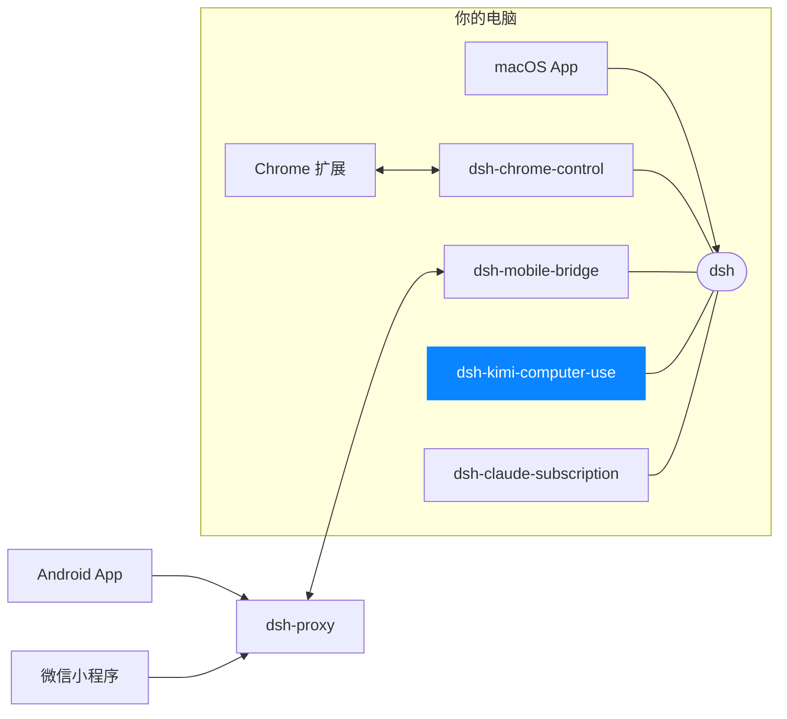

# dsh-kimi-computer-use

[English](README.md)

一个 [DeepSeek Harness（DSH）](https://github.com/deepseek-ai/deepseek-harness) 组合包（bundle）：通过通用的 [`@deepseek-ai/dsh-mcp-client`](https://www.npmjs.com/package/@deepseek-ai/dsh-mcp-client) 桥接，把 [Kimi Computer Use](https://www.kimi.com/) 的 stdio MCP 服务器接入 DSH，并附带一份驱动它的技能（skill）。

这是一个第三方互操作插件。收录本插件不代表 DeepSeek 或 Moonshot AI（Kimi Computer Use 的开发方）的认可、推荐、合作关系或持续支持承诺。

## 这个插件负责什么，不负责什么

| 关注点 | 本插件 | 你 / KimiCU.app |
|---|---|---|
| 插入一行 `@deepseek-ai/dsh-mcp-client`，以 stdio 方式启动 `kimi-cu mcp` | 是 | — |
| 发现并注册 KimiCU 的 MCP 工具，命名为 `mcp__cu__<tool>` | 是 | — |
| 注册内置的 `kimi-computer-use` 技能（交互循环与安全规则） | 是 | — |
| 下载、校验或安装 `KimiCU.app` | 否 | 是——请从 Kimi 官方渠道安装 |
| Bundle ID／arm64／Team ID／`codesign` 校验 | 否 | 由 KimiCU.app 自己的安装程序处理 |
| 启动、停止或监管 KimiCU 后台服务 | 否 | 是——请自行保持该应用运行 |
| 授予辅助功能／屏幕录制权限 | 否 | 是——请在 KimiCU.app 自身界面中授予 |

DSH 会按本插件的生命周期启动和停止 `kimi-cu mcp` 这个 stdio 子进程，但不会管理 KimiCU.app 本身。

## 前置条件

- Apple Silicon Mac，macOS 14 或更高版本。
- 已从 Kimi 官方渠道安装并保持运行 [`KimiCU.app`](https://www.kimi.com/)，并已在其自身界面中授予辅助功能与屏幕录制权限。
- 一份 DSH 安装（`@deepseek-ai/dsh`），其 `dsh` CLI 自带 `@deepseek-ai/dsh-mcp-client`（已发布的 `@deepseek-ai/dsh >= 0.1.1-rc.2` 满足此条件）。

## 安装

安装进一个 profile（完整机制见[插件与 profile 教程](https://github.com/deepseek-ai/deepseek-harness/blob/main/docs/user/develop/basic/publish.md)）：

```sh
dsh plugin --profile demo add dsh-kimi-computer-use          # 发布到 npm 后
dsh plugin --profile demo add ./dsh-kimi-computer-use        # 本地 checkout
dsh plugin --profile demo add github:<you>/dsh-kimi-computer-use#<sha>   # 从 git 安装，锁定到某个 commit
```

git 安装方式会运行本包的 `prepare` 脚本，从源码构建出 `lib/skills.js`；pnpm ≥10 会先拦截该脚本直到你显式允许。如果 `dsh plugin` 报告构建被拦截，把它打印出的确切包名键加入 profile 的 `pnpm-workspace.yaml`：

```yaml
allowBuilds:
  dsh-kimi-computer-use: true
```

然后重新执行 `add` 命令。只对你信任来源的包开启这项授权，并锁定到具体 commit，避免后续推送悄悄改变安装时实际运行的代码。

先不启动直接校验，再启动：

```sh
dsh --profile demo --dump-config   # 会看到一层 "# == dsh-kimi-computer-use"
dsh --profile demo
```

用 `dsh plugin --profile demo remove dsh-kimi-computer-use` 移除。

## 验证

1. 启动后等待 `mcp__cu__*` 工具出现（发现过程是异步的）。
2. 让 agent 列出当前打开的应用，确认它调用了 `mcp__cu__list_apps`（或对应发现到的工具），并从你正在运行的 KimiCU.app 得到真实结果。
3. 对任何 GUI 操作，内置技能会要求 agent 在执行发送、删除、购买、发布等难以撤回的操作前，先说明将发生的事情并征得你的确认。

## 安全

KimiCU.app 自身的安装程序会在安装前校验其 Bundle ID、arm64 架构和 Apple `codesign` 签名；这些校验都不经过本插件。请只从 Kimi 官方渠道安装 `KimiCU.app`。只对你信任、且已锁定到具体 commit 的 git 安装来源开启构建脚本授权。

## 开发

```sh
npm install
npm run check   # 构建后测试
npm pack --dry-run
```

## 许可证

MIT

<!-- dsh-family:start -->
## DSH App 家族

**DSH App** 是为 [DeepSeek Harness](https://github.com/deepseek-ai/deepseek-harness)（`dsh`）打造的一组客户端与插件。它们都接入你电脑上**同一个** dsh——会话、模型与插件处处互通，按需组合即可。下载与文档见 **[dshapp.github.io](https://dshapp.github.io/)**。



| | 项目 | 做什么 | 链接 |
| --- | --- | --- | --- |
| 客户端 | **macOS App**<br>`dsh-macapp` | 原生 SwiftUI 客户端，托管本机 dsh，一站式开启各个扩展 | [介绍](https://dshapp.github.io/products/macos/) · 源码待公开 |
|  | **Android App**<br>`dsh-androidapp` | 口袋里的 DSH：审批、提问、通知，端到端加密连回电脑 | [介绍](https://dshapp.github.io/products/android/) · 源码待公开 |
|  | **微信小程序 DSH Remote**<br>`dsh-miniapp` | 免安装，iPhone / Android 的微信里扫码接管 DSH | [介绍](https://dshapp.github.io/products/miniapp/) · 源码待公开 |
|  | **Chrome 扩展**<br>`dsh-chrome-extension` | 浏览器侧栏里的 DSH 客户端，也是浏览器控制的执行端 | [介绍](https://dshapp.github.io/products/chrome/) · 源码待公开 |
| dsh 插件 | **浏览器控制**<br>`dsh-chrome-control` | 把你已登录的 Chrome 作为 `mcp__chrome__*` 工具交给 Agent | [介绍](https://dshapp.github.io/products/chrome/) · [源码](https://github.com/dshapp/dsh-chrome-control) |
|  | **移动端桥接**<br>`dsh-mobile-bridge` | 经 Noise 加密隧道把 dsh 交给已配对的手机，不开端口 | [介绍](https://dshapp.github.io/products/android/) · [源码](https://github.com/dshapp/dsh-mobile-bridge) |
|  | **电脑操作** ← 你在这里<br>`dsh-kimi-computer-use` | 让 Agent 在后台操作没有 API 的 Mac 应用 | [介绍](https://dshapp.github.io/products/cu/) |
|  | **Claude 订阅**<br>`dsh-claude-subscription` | 用 Claude Code 订阅在 DSH 里跑 Claude 模型，不用另买 API Key | [源码](https://github.com/dshapp/dsh-claude-subscription) |
| 基础设施 | **中转服务**<br>`dsh-proxy` | 手机远程唯一的公网组件：单端口、只转发密文、无状态 | [介绍](https://dshapp.github.io/docs/crypto/) · [源码](https://github.com/dshapp/dsh-proxy) |
|  | **产品站**<br>`dshapp.github.io` | 下载、文档与更新日志 | [介绍](https://dshapp.github.io/) · [源码](https://github.com/dshapp/dshapp.github.io) |
<!-- dsh-family:end -->
